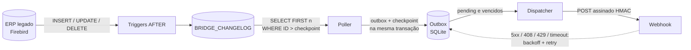

# legacy-bridge

[](https://github.com/SEU_USUARIO/legacy-bridge/actions/workflows/ci.yml)

Agente em .NET 8 que detecta mudanças no banco Firebird de um ERP legado e as entrega como eventos assinados para um webhook, com entrega garantida via outbox local.

> Projeto de portfólio. O schema e os dados da demo são 100% fictícios e não se referem a nenhum ERP ou empresa real.

## Como funciona



1. Triggers nas tabelas do ERP gravam `(tabela, id, operação)` em `BRIDGE_CHANGELOG`.
2. O **Poller** lê o changelog a partir do último ID processado, carrega a linha atual de cada registro (para `I`/`U`) e grava os eventos na outbox SQLite **na mesma transação** em que avança o checkpoint.
3. O **Dispatcher** envia os itens pendentes ao webhook, em ordem de `changelog_id`, e aplica a política de retry.

## Quickstart

Pré-requisito: Docker com Compose v2.

```bash
cd demo
docker compose up --build
```

Isso sobe quatro serviços:

| Serviço | O que faz |
|---|---|
| `firebird` | Firebird 5 com o banco de demo criado por `demo/firebird/init.sql` (tabelas, triggers e seed) |
| `webhook-receiver` | API de exemplo que valida a assinatura e guarda os eventos em memória, exposta em `localhost:5080` |
| `bridge` | o agente |
| `simulator` | faz um insert, update ou delete aleatório a cada 3 s |

Os ~60 inserts do seed já viram eventos assim que o bridge sobe. Para ver os últimos 50 recebidos:

```bash
curl -s http://localhost:5080/events | jq
```

O receptor responde `503` em 20% das requisições (`FAIL_RATE=0.2`) para mostrar o retry nos logs do bridge:

```bash
docker compose logs -f bridge
```

A demo funciona sem `.env`, com segredos de demonstração embutidos no `docker-compose.yml`. Para usar os seus, copie `demo/.env.example` para `demo/.env` e edite. Para recomeçar do zero (banco, checkpoint e outbox): `docker compose down -v`.

## Rodando como Windows Service

O host usa `AddWindowsService()`. Fora de um serviço do Windows, isso não faz nada, então o mesmo binário roda em console, Linux e Docker.

```powershell
# 1. Publicar
dotnet publish src/LegacyBridge.Worker -c Release -r win-x64 --self-contained -o C:\LegacyBridge

# 2. Configurar segredos como variáveis de ambiente de máquina (ou edite C:\LegacyBridge\appsettings.json
#    a partir do appsettings.Example.json, protegendo o arquivo com ACL)
[Environment]::SetEnvironmentVariable("Bridge__Firebird__ConnectionString", "DataSource=localhost;Database=C:\ERP\DADOS.FDB;User=BRIDGE;Password=...;Charset=UTF8", "Machine")
[Environment]::SetEnvironmentVariable("Bridge__Webhook__Url", "https://seu-endpoint/webhook", "Machine")
[Environment]::SetEnvironmentVariable("Bridge__Webhook__Secret", "<segredo com 32+ caracteres>", "Machine")

# 3. Criar e iniciar o serviço (o espaço depois de "binPath=" e "start=" é obrigatório)
sc.exe create LegacyBridge binPath= "C:\LegacyBridge\LegacyBridge.Worker.exe" start= delayed-auto
sc.exe description LegacyBridge "Envia mudanças do ERP para o webhook"
sc.exe failure LegacyBridge reset= 86400 actions= restart/5000/restart/5000/restart/30000
sc.exe start LegacyBridge
```

Caminhos relativos (`logs/`, `data/bridge.db`) são resolvidos a partir da pasta do executável, e não de `C:\Windows\System32`. Os logs ficam em `C:\LegacyBridge\logs\bridge-AAAAMMDD.log`.

Para remover: `sc.exe stop LegacyBridge` e depois `sc.exe delete LegacyBridge`.

No banco de produção, rode as partes de changelog e triggers do `init.sql` adaptadas às suas tabelas, e crie um usuário Firebird só com `SELECT` nas tabelas mapeadas e no changelog.

## Configuração

Seção `Bridge` do `appsettings.json`. Qualquer chave pode vir de variável de ambiente usando `__` como separador (ex.: `Bridge__Webhook__Url`). Para desenvolvimento local, use user-secrets:

```bash
cd src/LegacyBridge.Worker
dotnet user-secrets set "Bridge:Webhook:Secret" "$(openssl rand -hex 32)"
dotnet user-secrets set "Bridge:Firebird:ConnectionString" "DataSource=localhost;Port=3050;Database=/var/lib/firebird/data/erp_demo.fdb;User=bridge;Password=demo-firebird-password;Charset=UTF8"
dotnet user-secrets set "Bridge:Webhook:Url" "http://localhost:5080/webhook"
dotnet run
```

| Chave | Padrão | Descrição |
|---|---|---|
| `SourceName` | `erp-demo` | Vai no campo `source` do payload e identifica o checkpoint |
| `PollingIntervalSeconds` | `5` | Intervalo entre leituras do changelog |
| `BatchSize` | `100` | Máximo de linhas por leitura do changelog e por lote de envio |
| `Firebird:ConnectionString` | — | **Obrigatório. Segredo:** use env var ou user-secrets |
| `Firebird:ChangelogTable` | `BRIDGE_CHANGELOG` | Nome da tabela de changelog |
| `Firebird:ServerTimeZone` | `UTC` | Fuso em que o servidor grava `CRIADO_EM`, usado para converter `occurredAt` para UTC (ex.: `America/Sao_Paulo`) |
| `Tables[]` | 3 tabelas | `Table` (nome no Firebird), `Entity` (nome no payload), `KeyColumn` (chave inteira) |
| `Webhook:Url` | — | **Obrigatório.** URL http(s) do destino |
| `Webhook:Secret` | — | **Obrigatório, mínimo de 32 caracteres. Segredo:** use env var ou user-secrets |
| `Webhook:TimeoutSeconds` | `10` | Timeout de cada POST |
| `Retry:MaxAttempts` | `10` | Tentativas até marcar o evento como `dead` |
| `Retry:BaseDelaySeconds` | `2` | Base do backoff exponencial |
| `Retry:MaxDelaySeconds` | `300` | Teto do backoff, antes do jitter |
| `Storage:SqlitePath` | `data/bridge.db` | Arquivo da outbox e do checkpoint |

A configuração é validada na inicialização. O processo não sobe se faltar URL ou connection string, se o segredo for curto ou se algum nome de tabela ou coluna não casar com `^[A-Z][A-Z0-9_]{0,30}$`.

`appsettings.Example.json` mostra uma configuração completa com placeholders.

## Payload e assinatura

```http
POST /webhook HTTP/1.1
Content-Type: application/json
X-Bridge-Event-Id: 019a7b3c-5e2f-7d41-9c3a-2b8e4f6a1d07
X-Bridge-Timestamp: 1794405600
X-Bridge-Signature: sha256=5d1c...e9

{
  "eventId": "019a7b3c-5e2f-7d41-9c3a-2b8e4f6a1d07",
  "occurredAt": "2026-11-11T14:00:00Z",
  "source": "erp-demo",
  "entity": "pedido",
  "operation": "updated",
  "entityId": 123,
  "data": { "id": 123, "clienteId": 7, "data": "2026-11-10T09:12:00", "status": "PAGO", "total": 412.90 }
}
```

- `eventId`: UUID v7, ordenável por tempo. Use-o para deduplicar, já que a entrega é *at-least-once*.
- `operation`: `created`, `updated` ou `deleted`.
- `occurredAt`: momento em que a trigger registrou a mudança, em UTC.
- `data`: estado **atual** da linha no momento da leitura, com as colunas em camelCase. Vem `null` em `deleted`, ou se a linha já tiver sido apagada quando o bridge a leu.

**Respostas esperadas do receptor:**

| Resposta | O que o bridge faz |
|---|---|
| `2xx` | marca como `sent` |
| `4xx`, exceto 408 e 429 | marca como `dead` imediatamente, sem retry |
| `5xx`, `408`, `429`, timeout ou erro de rede | tenta de novo com `min(Base × 2^tentativas, Max)` + 0–20% de jitter; respeita `Retry-After` em 429/503 |

**Assinatura:** `X-Bridge-Signature = "sha256=" + hex(HMAC-SHA256(secret, "{X-Bridge-Timestamp}.{corpo bruto}"))`.

Para verificar:

1. Use o **corpo bruto**, antes de qualquer parse de JSON.
2. Rejeite se o timestamp estiver a mais de 5 minutos do relógio atual.
3. Compare as assinaturas em **tempo constante**.
4. Deduplique por `eventId`.

### C#

```csharp
using System.Security.Cryptography;
using System.Text;

static bool IsValid(string rawBody, string timestampHeader, string signatureHeader, string secret)
{
    if (!long.TryParse(timestampHeader, out var ts)) return false;
    var age = DateTimeOffset.UtcNow - DateTimeOffset.FromUnixTimeSeconds(ts);
    if (age.Duration() > TimeSpan.FromMinutes(5)) return false;

    var hash = HMACSHA256.HashData(Encoding.UTF8.GetBytes(secret), Encoding.UTF8.GetBytes($"{ts}.{rawBody}"));
    var expected = "sha256=" + Convert.ToHexString(hash).ToLowerInvariant();

    return CryptographicOperations.FixedTimeEquals(
        Encoding.ASCII.GetBytes(expected), Encoding.ASCII.GetBytes(signatureHeader));
}
```

A implementação completa, com deduplicação, está em [`tools/WebhookReceiver/Program.cs`](tools/WebhookReceiver/Program.cs).

### Node.js

```js
const crypto = require("node:crypto");
const express = require("express");

const app = express();
const SECRET = process.env.WEBHOOK_SECRET;

// express.raw: precisamos dos bytes exatos para conferir a assinatura
app.post("/webhook", express.raw({ type: "application/json" }), (req, res) => {
  const ts = req.get("X-Bridge-Timestamp");
  const signature = req.get("X-Bridge-Signature") ?? "";
  const rawBody = req.body.toString("utf8");

  if (!/^\d+$/.test(ts ?? "") || Math.abs(Date.now() / 1000 - Number(ts)) > 300) {
    return res.sendStatus(401);
  }

  const expected = "sha256=" + crypto.createHmac("sha256", SECRET).update(`${ts}.${rawBody}`).digest("hex");
  const a = Buffer.from(expected);
  const b = Buffer.from(signature);
  if (a.length !== b.length || !crypto.timingSafeEqual(a, b)) {
    return res.sendStatus(401);
  }

  const event = JSON.parse(rawBody);
  // ...deduplicar por event.eventId e processar...
  res.sendStatus(200);
});

app.listen(3000);
```

## Decisões técnicas

### Por que triggers + changelog em vez de comparar timestamps

Comparar uma coluna `ATUALIZADO_EM` parece mais simples, mas falha em pontos que importam:

- **Deletes:** uma linha apagada não aparece em nenhuma consulta por timestamp.
- **Disciplina do legado:** a coluna só é confiável se *todo* código que escreve na tabela a atualiza. Em ERP legado sempre há uma rotina, um script ou uma correção manual que não atualiza.
- **Empates e relógio:** várias mudanças no mesmo instante, ou o relógio do servidor voltando, fazem o "maior timestamp visto" pular ou repetir registros.
- **Custo:** varrer tabelas grandes por timestamp a cada poucos segundos pesa num banco que não foi pensado para isso.

As triggers capturam toda escrita, de qualquer origem, inclusive deletes. A sequence dá um ID monotônico que serve de checkpoint exato e barato (`WHERE ID > ?`, usando a PK). O custo é um `INSERT` pequeno por mudança, dentro da mesma transação do ERP: se a transação faz rollback, o registro no changelog some junto.

Limitação conhecida: valores de sequence são reservados fora da transação. Uma transação longa pode commitar o ID 100 depois que o bridge já leu o 101 e avançou o checkpoint, e então o 100 é pulado. Para ERPs com transações longas, o caminho é ler com atraso de segurança ou rastrear lacunas de ID (veja o Roadmap).

### Por que outbox local

Ler do Firebird e enviar via HTTP são duas operações que podem falhar de forma independente. Sem um passo intermediário durável, ou o checkpoint avança antes do envio e um crash perde eventos, ou o envio acontece antes do checkpoint e eventos são reenviados sem controle.

A outbox SQLite separa as duas coisas:

- O Poller grava os eventos e avança o checkpoint **na mesma transação**. Ou os dois acontecem, ou nenhum.
- `UNIQUE(changelog_id)` com `INSERT OR IGNORE` torna o Poller idempotente: reler o mesmo trecho do changelog não duplica eventos.
- O Dispatcher trabalha só com dados locais. Webhook fora do ar não trava a leitura do ERP, e os retries com backoff **sobrevivem a restart**, porque estado e próxima tentativa ficam em disco.
- Não é preciso criar nada no banco do ERP além do changelog. O estado de entrega fica com o agente.

Por isso o `HttpClient` não tem política de retry própria, só timeout. Quem decide sobre novas tentativas é a outbox. O resultado é entrega *at-least-once*: o receptor deve deduplicar por `eventId`.

### Por que HMAC com timestamp

- **HMAC-SHA256** prova que o corpo veio de quem tem o segredo e não foi alterado. Ao contrário de um token fixo no header, o segredo nunca trafega.
- **Timestamp dentro da assinatura** (`"{timestamp}.{corpo}"`) impede replay: uma requisição capturada só é aceita por 5 minutos, e trocar o timestamp invalida a assinatura.
- **Comparação em tempo constante** (`FixedTimeEquals` / `timingSafeEqual`) evita vazar, pelo tempo de resposta, quantos bytes da assinatura estavam corretos.
- **Dedup por `eventId`** cobre o replay que sobra dentro da janela e as reentregas legítimas do retry.

### Outras salvaguardas

- Nomes de tabela e coluna só entram em SQL se vierem da configuração e casarem com `^[A-Z][A-Z0-9_]{0,30}$`. Valores sempre são parâmetros.
- Os logs registram `eventId`, entidade, `entityId`, status HTTP e tentativa. Nunca registram segredo, connection string ou payload.
- Shutdown gracioso: ao receber o sinal de parada, o Dispatcher não começa novos envios, mas termina e persiste o que estiver em andamento.

## Roadmap

- **Múltiplos destinos:** vários webhooks por entidade, cada um com outbox, segredo e política de retry próprios.
- **Mapeamento de campos:** escolher, renomear e transformar colunas por entidade em vez de enviar a linha inteira, além de mascarar dados sensíveis.
- **Painel web:** ver a outbox (pendentes, `dead`, últimos erros), reenviar eventos `dead` e acompanhar o atraso em relação ao changelog.
- Proteção contra lacunas de sequence em transações longas.
- Limpeza periódica dos itens `sent` antigos da outbox.

## Estrutura

```
src/LegacyBridge.Core            modelos, opções, validação, retry, assinatura
src/LegacyBridge.Infrastructure  Firebird (Dapper), SQLite (outbox), envio HTTP
src/LegacyBridge.Worker          host: Poller, Dispatcher, Serilog, Windows Service
tools/WebhookReceiver            receptor de exemplo (Minimal API)
tools/DataSimulator              gerador de mudanças para a demo
tests/LegacyBridge.Tests         testes unitários e de integração com SQLite
demo/                            docker-compose e init.sql do Firebird
```

```bash
dotnet build LegacyBridge.sln
dotnet test LegacyBridge.sln
```

## Licença

[MIT](LICENSE)
